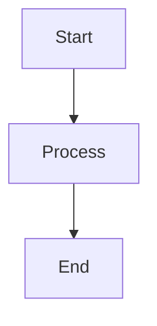

# Advanced Markdown Rendering

## Multi-file Projects

### Batch Processing
Convert multiple markdown files at once:

```bash
# Convert all .md files in directory
for file in *.md; do
    python scripts/md_to_html.py "$file" --theme professional
done

# Or use find for recursive processing
find . -name "*.md" -exec python scripts/md_to_html.py {} --theme github \;
```

### Table of Contents Generation
For documents with multiple sections:

```bash
# Generate HTML with TOC
python scripts/md_to_html.py document.md --theme academic
```

The TOC is automatically generated from headers and inserted at the top.

## Custom Plugins and Extensions

### Syntax Highlighting
Supported languages in code blocks:
- Python, JavaScript, TypeScript, Java, C++, C#, Go, Rust
- HTML, CSS, JSON, YAML, XML
- SQL, Bash, PowerShell
- And many more via Pygments

### Mathematical Expressions
Add MathJax support by including in custom CSS:

```html
<script src="https://polyfill.io/v3/polyfill.min.js?features=es6"></script>
<script src="https://cdn.jsdelivr.net/npm/mathjax@3/es5/tex-mml-chtml.js"></script>
```

Then use LaTeX syntax:
```markdown
$$E = mc^2$$
```

### Mermaid Diagrams
Include Mermaid.js for diagrams:

```html
<script src="https://cdn.jsdelivr.net/npm/mermaid/dist/mermaid.min.js"></script>
<script>mermaid.initialize({startOnLoad:true});</script>
```

Then create diagrams:
```markdown

```

## Template Customization

### Custom Themes
Create your own theme by extending base CSS:

```css
/* custom-theme.css */
@import url('https://fonts.googleapis.com/css2?family=Inter:wght@300;400;600&display=swap');

body {
    font-family: 'Inter', sans-serif;
    background: linear-gradient(135deg, #667eea 0%, #764ba2 100%);
    color: #2d3748;
}

.markdown-body {
    background: white;
    border-radius: 12px;
    box-shadow: 0 10px 25px rgba(0,0,0,0.1);
    padding: 60px;
}

h1 {
    background: linear-gradient(45deg, #667eea, #764ba2);
    -webkit-background-clip: text;
    -webkit-text-fill-color: transparent;
    font-weight: 600;
}
```

Use with:
```bash
python scripts/md_to_html.py input.md --css custom-theme.css
```

### Page Layout Options
Control page breaks for PDF generation:

```css
/* Add to custom CSS */
@media print {
    h1 { page-break-before: always; }
    h2 { page-break-after: avoid; }
    pre, blockquote { page-break-inside: avoid; }
}
```

## Integration Workflows

### Documentation Generation
Create a documentation site:

1. Organize markdown files in logical structure
2. Create an index.md as homepage  
3. Batch convert all files with consistent theme
4. Add navigation between pages with relative links
5. Deploy to web server or GitHub Pages

### Report Generation
For business reports:

1. Use professional theme
2. Include custom CSS for branding
3. Add cover page with company logo
4. Generate PDF for distribution
5. Automate with build scripts

### Blog Publishing
Convert markdown posts to HTML:

1. Use minimal theme for clean reading
2. Add metadata frontmatter to markdown
3. Process frontmatter to generate post listings
4. Include social sharing buttons
5. Optimize for SEO with proper meta tags